# Dhriti (धृति) · a voice-first OCD companion for India

> *Dhriti* is Sanskrit for steadfast resolve: in the Bhagavad Gita (18.33), the steadiness that holds the mind, the breath and our actions. That is the core skill of OCD treatment: noticing the urge and **not** acting on it.

Dhriti helps people with obsessive-compulsive disorder practise **exposure and response prevention (ERP)** at the exact moment an urge hits, by **talking** in Hindi, Hinglish, English, Tamil or Bengali. It screens with validated instruments, routes people to the right level of care, connects them with **KYC-verified psychiatrists and RCI psychologists**, and is tested in a **Safety Lab** built on our own research benchmark, [OCD-EVAL](https://github.com/meenakshisatpathy20-del/OCD-EVAL).

> **Research prototype.** Dhriti supports care; it does not diagnose or replace a clinician. In crisis in India call **Tele-MANAS 14416** (free, 24x7), or **112** for emergencies.

---

## Why voice?

OCD urges and panic strike when hands are wet, busy or shaking. Typing is the one thing people can't do in that moment, but they can speak. People also describe intrusive thoughts more honestly in their mother tongue, and the Y-BOCS was designed as a spoken clinical interview. In Dhriti, voice is the main way in, not an add-on.

## Features

| Area | What it does | Voice |
|---|---|---|
| **Talk to Dhriti** (AI agent) | Understands what you say and acts: opens the urge coach, panic mode, diary, lessons, booking | Speak in 4 languages + Hinglish; optional hands-free "Dhriti, madad" |
| **Spoken screening** | OCI-R (≥21 = likely OCD), Y-BOCS severity bands, and a mood check (PHQ-2 + the PHQ-9 self-harm item) that raises care for low mood and opens crisis support immediately if needed | Answer in your own words ("kaafi", "more than 8 hours") |
| **Stepped-care routing** | Care levels 1-4: wellbeing → guided self-help → therapist-supported ERP → psychiatrist first | – |
| **Urge coach (ERP)** | Extracts trigger, fear and compulsion; 2-minute waiting rounds with spoken 0-10 anxiety ratings; outcome logged without judgement | "Phir se haath dhone ka mann ho raha hai" |
| **Therapist ERP plan** | The professional writes the patient's ERP plan in the portal; the patient accepts it; Dhriti repeats it word for word during urges and reassurance requests | ✓ |
| **Reassurance guard** | Never answers "are you sure?"; recognises fact / bargain / guilt / proxy pressure; tracks reassurance loops | Fully spoken |
| **Voice panic button** | Calm screen; calibrated microphone hears each exhale and a star dims as breaths lengthen; "Maa ko bulao" opens WhatsApp to a trusted contact | Breath is the input |
| **Exposure ladder** | Build ERP steps by voice ("bus ki seat chhoona, saat"); profile-matched suggestions | ✓ |
| **360° practice** | Three WebGL exposure scenes (washroom, gas stove, front door), drag/gyro look-around, WebXR "Enter VR" for cardboard viewers | "aage", "bas", anxiety numbers |
| **Meditate & music** | Bhramari humming (mic detects voiced pitch and paces you), thought labelling ("yeh OCD bol raha hai"), spoken body scan, generative ambient music assigned per situation | You speak, not just listen |
| **Lessons** | 9 psychoeducation lessons (OCD, the cycle, ERP, reassurance, intrusive thoughts, family, panic, treatment, relapse), read aloud, voice quiz | ✓ |
| **Voice diary & report** | Private spoken diary; 14-day report with Y-BOCS trend, peak-anxiety trend, outcomes; printable PDF; shared only with consent | ✓ |
| **Professional marketplace** | KYC onboarding (council, registration number, qualification, certificate upload); human verification console; booking online/offline; patient-doctor chat; consented report sharing | Chat works with dictation |
| **Safety Lab (OCD-EVAL)** | Our OCD-EVAL benchmark as a working tool: study results; Dhriti's own results; **grade any chatbot** by pasting its reply; a copy-paste **five-turn pressure test**; **run any connected model** raw (study prompt) or behind Dhriti's safety layer; export in OCD-EVAL transcript format for the study's LLM judge | – |
| **Wispr Flow mode** | Every text box is dictation-ready; a global mode switches all input to text boxes for Wispr Flow | See [docs/WISPR_FLOW.md](docs/WISPR_FLOW.md) |
| **Privacy & calm** | Data stays on the device; Quiet mode for shared homes; calm visuals; export / delete all data; works offline (service worker) | – |
| **Warm design** | Doodled cosmos, Tara the star mascot (bobs, blinks, listens, celebrates), orbiting planets round the mic, sound bars, star-burst celebrations, breathing ring; all motion stops in calm mode | – |
| **Chat safety** | Risky messages to a professional show crisis help at once and are flagged urgent in the portal | – |

## The AI/ML pipeline, end to end

```mermaid
flowchart LR
  V[Voice / Wispr Flow / text] --> S[1 · On-device safety screen<br/>self-harm, emergency]
  S --> U[2 · Hybrid NLP<br/>multilingual rules + Naive Bayes]
  U --> A[3 · Agent planner<br/>LLM with tools, or offline planner]
  A --> I[4 · Clinical invariants<br/>no reassurance, urge → ERP, level 4 → psychiatrist]
  I --> G[5 · Guardrails<br/>reassurance, risk framing, diagnosis, medication]
  G --> R[Spoken reply + app actions]
  R --> M[6 · Measurement<br/>OCI-R, Y-BOCS, SUDS, outcomes]
  M --> C[7 · Stepped care<br/>verified professional + consented report]
```



Details: [docs/ARCHITECTURE.md](docs/ARCHITECTURE.md).

## Research components

| Component | Command | Output |
|---|---|---|
| **ML pipeline** on the public OCD patient dataset (1,500 records): audit → train → cross-validate → export | `npm run ml` | [ml/reports/REPORT.md](ml/reports/REPORT.md) |
| **OCD-Eval (intent)**: does Dhriti understand what people say? 145 labelled utterances (8 intents) in 5 language groups + held-out set, self-harm release gate | `npm run eval` | [eval/RESULTS.md](eval/RESULTS.md) |
| **Safety Lab (OCD-EVAL behaviour)**: Dhriti's agent vs. our OCD-EVAL scenarios, grader validated against hand labels | `npm run lab` | [lab/RESULTS.md](lab/RESULTS.md) |
| **Unit tests** (54) | `npm test` | – |

### Key findings (honest)

1. **The public OCD dataset is synthetic.** Our audit found ~48% of rows exceed the Y-BOCS subscale maximum (20), obsession and compulsion scores are uncorrelated (r = 0.03), and contamination is not linked to washing (χ² p = 0.83). Models trained on it perform at chance. So **clinical decisions in Dhriti come only from validated instruments and published thresholds**; the pipeline is built to be re-run on real, ethically collected data.
2. **Keyword rules do not generalise.** On a held-out set, exact-phrase self-harm recall was 0.25. We added a broad, self-directed soft-risk check-in (held-out safety catch 1.00) and an optional language-model layer, and we name a clinician-labelled dataset as the next step.
3. **Knowing is not doing.** Our OCD-EVAL study showed models that triage OCD perfectly can still tell a mother with harm OCD to step away from her baby. Dhriti turns those findings into guardrails; in the Safety Lab it passes 3/3 OCD conversations and holds the line for 5/5 turns under pressure, and its offline grader agrees with 100% of OCD-EVAL's 65 hand-labelled verdicts. (Not a blind benchmark: see [lab/RESULTS.md](lab/RESULTS.md).)

## Deploy (recommended for demos)

Dhriti is one Node service (web app + API). The free Render plan is enough.

1. Sign in at [render.com](https://render.com) with GitHub.
2. **New → Blueprint** → pick this repository. Render reads `render.yaml`.
3. Click **Apply**. After about 3-5 minutes you get a public HTTPS link (HTTPS is required for the microphone).
4. In the service's **Environment** tab, copy `ADMIN_TOKEN` (generated for you) for the `/admin` page.
5. Optional: set `LLM_BASE_URL`, `LLM_API_KEY`, `LLM_MODEL` to connect any OpenAI-compatible model.

Notes: on the free plan the service sleeps after 15 minutes idle (the first visit then takes about 50 seconds), and bookings, chats and uploaded certificates reset on restart (patient data lives on the phone and is unaffected). Open the link once a few minutes before presenting. A `Dockerfile` is included for Railway, Fly.io or Cloud Run.

## Run it locally

Requirements: Node.js 20+ (22 recommended). Chrome on Android or desktop gives the best speech recognition.

```bash
npm install
npm run dev          # web on http://localhost:5173, API on http://localhost:8787
```

Production build:

```bash
npm run build && npm start      # serves the app and API on http://localhost:8787
```

Optional: connect the agent to any OpenAI-compatible chat API by copying `.env.example` to `.env` and setting `LLM_BASE_URL`, `LLM_API_KEY` and `LLM_MODEL`. Without them the agent runs fully offline. Admin console: `/admin` (token from `ADMIN_TOKEN`, default `dhriti-admin` for local demos).

### Demo path (5 minutes)

0. Optional: **Profile → Load demo data** fills four weeks of fictional history (Y-BOCS 22 → 14), so charts and reports are not empty.
1. Onboard in Hindi → **Talk to Dhriti**: say *"phir se haath dhone ka mann ho raha hai"* → urge coach opens with trigger/fear/urge → rate anxiety by voice.
2. Say *"pakka saaf hai na?"* twice → reassurance is declined and the loop is detected.
3. **SOS** → breathe out into the mic and watch the star dim.
4. **Screening** → OCI-R + Y-BOCS by voice → care level → **Find a professional** → book → chat → share report.
5. **For professionals** → apply with KYC → **/admin** verify → sign in to the portal and see the shared report.
6. **Safety Lab** → *Run the lab live* → see Dhriti pass the OCD-EVAL scenarios turn by turn.
7. **ML pipeline** → show the data audit and why the models are not used clinically.

## Project structure

```
shared/      clinical instruments, NLP, agent, ML toolkit, lab (used by web, API and CLIs)
src/         React app (pages, voice components, doodle-cosmos design system)
server/      Express API: agent, professionals/KYC, bookings, chat, admin
ml/          dataset, pipeline, generated model and report
eval/        OCD-Eval intent dataset, held-out set, runner and results
lab/         vendored OCD-EVAL scenarios, Safety Lab runner and results
tests/       unit tests
docs/        architecture, clinical basis, ML, evaluation, Wispr Flow, ethics & privacy
```

## Documentation

- [Architecture](docs/ARCHITECTURE.md)
- [Clinical basis](docs/CLINICAL.md)
- [ML pipeline](docs/ML.md)
- [Evaluation & Safety Lab](docs/EVALUATION.md)
- [Wispr Flow](docs/WISPR_FLOW.md)
- [Ethics, privacy & safety](docs/ETHICS_PRIVACY.md)

## Author

Meenakshi Satpathy · research project on voice-first, ERP-based support for OCD in India.
